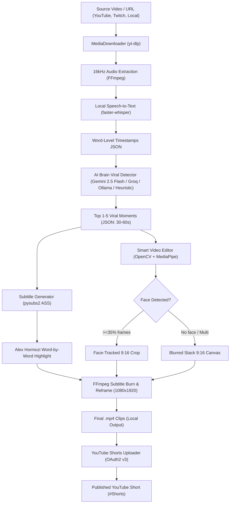

# ⚡ Clipwa - Automated Viral Clipping & YouTube Shorts Pipeline

[](https://opensource.org/licenses/MIT)
[](https://python.org)
[](#)

**Clipwa** is a 100% free, open-source, automated end-to-end Python pipeline that converts long-form videos and podcasts (YouTube, Twitch, local files, etc.) into high-retention, viral 9:16 vertical **YouTube Shorts**, **TikToks**, and **Instagram Reels**.

No paid SaaS clipping subscriptions (OpusClip, Klap, Munch) required. Powered by modern open-source models and Google's free Gemini 2.5 Flash API.

---

## 🌟 Key Features

1. **High-Quality Media Downloader (`yt-dlp` + `FFmpeg`)**:
   - Supports YouTube, Twitch, Twitter/X, direct video URLs, and local video/audio files.
   - Extracts 16kHz mono audio optimized for Whisper speech-to-text.

2. **Fast Local Transcription (`faster-whisper`)**:
   - Runs 100% locally on CPU or GPU with `int8`/`float16` quantization.
   - Generates exact word-level timestamps and timestamps metadata.
   - Voice Activity Detection (VAD) eliminates silent periods.

3. **Viral Moment AI Brain (`gemini-2.5-flash`)**:
   - Uses the official `google-genai` SDK on the free tier of **Gemini 2.5 Flash**.
   - Prompts for high-retention moments (30–60s) with hooks, viral titles, descriptions, and hashtags.
   - Automatic fallbacks: Groq (`llama-3.3-70b`), local Ollama (`llama3`), or built-in heuristic rule-based detection for offline execution.

4. **Smart 9:16 Framing & Auto-Crop (`MediaPipe` + `OpenCV`)**:
   - **Face-Tracking Crop**: Detects active speaker face position using MediaPipe BlazeFace / OpenCV Haar Cascades and crops a smooth 9:16 vertical window.
   - **Blurred-Background Stack**: For wide shots, gaming streams, or group discussions, zooms and heavily blurs the background while centering the 16:9 foreground.
   - **Auto Mode**: Intelligently switches based on face presence across sampled frames.

5. **Engaging Alex Hormozi Animated Captions (`pysubs2` + `libass`)**:
   - Fast, punchy 2–4 words per line.
   - Word-by-word karaoke highlighting (active word turns bright yellow, cyan, or green with dynamic scaling).
   - Thick black outlines, bold typography (Arial Black, Impact, Montserrat), and lower-third placement tuned for YouTube Shorts UI.

6. **YouTube Data API v3 Direct Uploader**:
   - OAuth 2.0 flow with token caching (`token.json`).
   - Resumable 4MB chunked uploading.
   - Automatically appends `#Shorts`, sets category, and supports `private`, `unlisted`, or `public` visibility.

7. **Dual Interface**:
   - **Rich Terminal CLI**: Interactive CLI with tables, spinners, and detailed logging.
   - **Modern Web Dashboard**: Built-in, zero-dependency browser UI with in-player preview and 1-click publishing.

---

## 🏛️ Architecture



---

## 🚀 Quick Start Guide

### 1. Installation

Clone or enter the `clipwa` folder:

```bash
cd clipwa
pip install -r requirements.txt
pip install -e .
```

### 2. Configure Environment (Optional for Gemini)

Copy `.env.example` to `.env`:

```bash
cp .env.example .env
```

Add your free Gemini API key from [Google AI Studio](https://aistudio.google.com/):
```env
GEMINI_API_KEY=your_gemini_api_key_here
```
*(Note: If no API key is provided, Clipwa automatically uses its built-in rule-based heuristic detector, so it works out-of-the-box offline!)*

---

## 💻 CLI Usage

### Full Automated Pipeline

Run the entire pipeline on any video URL:

```bash
clipwa process "https://www.youtube.com/watch?v=YOUR_VIDEO_ID" --max-clips 3
```

Process a local video file with custom caption styling:

```bash
clipwa process "C:/path/to/podcast.mp4" --layout face_track --theme neon_cyan --words-per-line 3
```

### Upload Directly to YouTube Shorts

```bash
clipwa process "https://www.youtube.com/watch?v=..." --upload --privacy unlisted
```

### Individual Subcommands

```bash
# 1. Transcribe audio locally with word timestamps
clipwa transcribe "interview.mp4" --model tiny --output transcript.json

# 2. Detect viral moments from transcript
clipwa detect transcript.json --max-clips 3 --provider gemini

# 3. Cut & reframe 9:16 clip
clipwa cut "interview.mp4" --start 45.0 --end 88.0 --layout auto

# 4. Upload single clip to YouTube Shorts
clipwa upload "output/clip_1_short.mp4" --title "Mindblowing AI Secret #Shorts" --privacy private

# 5. Run built-in self test (zero-network verification)
clipwa test
```

---

## 🌐 Web UI Dashboard

Clipwa includes a responsive, modern dark-mode browser dashboard:

```bash
clipwa web --port 8000
```

Open [http://127.0.0.1:8000](http://127.0.0.1:8000) in your browser:
- Paste video URLs or select local files.
- Toggle layout (Auto, Face Tracking, Blurred Stack).
- Select subtitle styles (Hormozi Yellow, Cyan, Green, Pink, White).
- Preview generated 9:16 clips directly in the browser video player.
- 1-click Download or 1-click YouTube Shorts publishing.

---

## 🐍 Python SDK API Usage

You can also use Clipwa directly in your own Python projects:

```python
from clipwa import ClipwaPipeline

pipeline = ClipwaPipeline(
    llm_provider="gemini",
    whisper_model="tiny",
)

result = pipeline.process_video(
    url_or_path="https://www.youtube.com/watch?v=example",
    max_clips=3,
    min_clip_duration=30.0,
    max_clip_duration=60.0,
    layout_mode="auto",
    caption_theme="hormozi_yellow",
    upload_to_youtube=False,
)

for clip in result["clips"]:
    print(f"Clip: {clip['youtube_title']}")
    print(f"Path: {clip['file_path']}")
    print(f"Virality Score: {clip['virality_score']}%")
```

---

## 📄 License

Clipwa is released under the **MIT License**. Free for personal and commercial automation.
